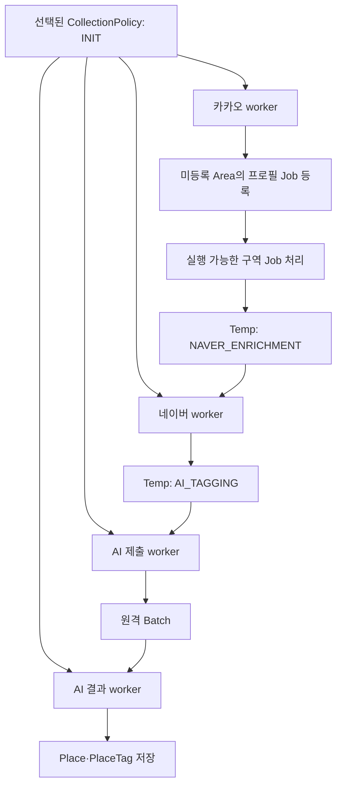

# 초기 Place 수집 스케줄링 가이드

작성: 2026-11-16. 단일 수집 서버 기준. 실제 운영 수집은 아직 시작하지 않았다.

## 1. 읽는 순서와 파일 구조

기준: `src/main/java/com/junsang/course_backend/domain/place/collection`.

```text
scheduling/
  config/
    CollectionSchedulingProperties.java  실행 설정, 처리량과 상한
    CollectionSchedulingConfig.java      정책 선택, Clock, 전용 스레드 4개
  policy/
    CollectionPolicy.java                대상 선정·실행 시간·단계별 설정 계약
    InitialCollectionPolicy.java         서울 미등록 Area를 ID순 1개씩 선택
  scheduler/
    KakaoCollectionScheduler.java        정책으로 Job 등록 후 미완료 구역 실행
    NaverRefinementScheduler.java        대기 장소 정제
    AiSubmissionScheduler.java           배치 상한·공급자 보류 확인 후 제출
    AiResultScheduler.java               제출과 독립적으로 결과 회수
  service/
    CollectionJobRegistrationService.java  Area 잠금 후 프로필 root 전체 등록
    CollectionExecutionState.java          readiness·시간·대기량 확인
    CollectionReadiness.java               시작 복구 완료 후 worker 허용
    CollectionRestartRecovery.java         단일 서버 시작 시 미완료 상태 복구
budget/
  ApiScope.java                         카카오 키워드/카테고리, 네이버 검색 공통 구분
  ApiCredential.java                    키 설정, toString에서 비밀 제외
  CollectionBudgetService.java          키 순회·오류 구분·재개 시각 계산
  CollectionBudgetWriter.java           대기 상태 조회·저장
  CollectionDeferredException.java      정상 대기 신호
pipeline/
  kakao/ naver/ ai/                     실제 검색·분할·정제·저장·오류 복구
```

HTTP 연결/읽기 타임아웃은 `global/config/ExternalApiClientConfig`에서 설정한다. 카카오·네이버 클라이언트는 실제 요청마다 BudgetService를 사용한다. AI Batch 클라이언트는 기존 전용 타임아웃 설정을 유지한다.

## 2. 네 단계 호출 흐름



- 정책은 작업 대상과 실행 가능 시간·각 단계 실행 간격·처리량을 제공한다. 운영 정책은 추후 같은 인터페이스로 추가한다. 런타임 즉시 교체가 아니라 설정 변경 후 재시작하는 방식이다.
- `CollectionSchedulingConfig.collectionPolicy`가 이름에 맞는 구현체를 선택한다. 미지원 이름은 시작 시 오류로 알린다.
- 각 @Scheduled는 선택된 정책의 설정을 읽어 서로 다른 poolSize=1 스레드에 등록된다.
- 03:00 KST부터 신규 검색·정제·AI 제출을 시작한다. 03시를 놓치고 기동해도 해당 날짜의 작업을 진행한다. 날짜가 바뀐 00:00~03:00에는 신규 처리를 보류한다. 카카오는 페이지/하위 구역 사이에도 시간을 확인한다. 네이버는 회당 묶음 시작에서 확인하므로 경계 시각을 조금 넘길 수 있다.
- AI 결과 회수는 readiness 이후 시간·신규 대기량·제출 상한과 독립적으로 계속된다.
- 기존 Area Job이 하나라도 있으면 신규 등록하지 않는다. 등록 트랜잭션에서 Area를 잠근 뒤 다시 확인하여 중복 root 생성을 막는다. 활성 프로필 전체를 원자적으로 만든다.
- 신규 Area는 READY/RUNNING Job이 없는 경우 ID순으로 1개 등록한다. 재시도 대기 FAILED/영구 실패/PARTIAL은 기존 이력으로 남기고 다른 Area 진행을 허용한다.
- 수동 collectArea/collectCity와 즉시 AI/통합 테스트 API는 제거했다. 신규 등록은 CollectionJobRegistrationService, 실행은 각 worker로 모았다.

## 3. 키 전환과 정상 대기

카카오·네이버 각각 main/team 두 인증 정보를 설정한다. 빈 인증 정보는 건너뛴다. 두 키는 사용자 합의에 따라 독립된 쿼터라고 가정한다.

| 상황 | 처리 |
|---|---|
| 정상 | main부터 사용 가능한 인증 정보로 요청 |
| 카카오 code=-10/-11 | 해당 키·검색 종류를 다음 KST 자정까지 보류하고 다음 키로 동일 요청 |
| 네이버 HTTP 429 + errorCode=400 | 해당 키의 지역·블로그 공통 검색을 다음 달 KST 1일 자정까지 보류하고 다음 키로 동일 요청 |
| 그 외 HTTP 429 | Retry-After 또는 60초 cooldown, 월간 소진으로 단정하지 않음 |
| HTTP 401/403 | 해당 인증 정보·scope를 운영 확인 전까지 보류하고 다음 키 확인 |
| 서버/통신/요청 형식 오류 | 다른 키의 소진으로 간주하지 않고 기존 오류 핸들러로 전달 |
| 모든 인증 정보 대기 | 가장 빠른 재개 시각으로 현재 작업 보류 |

숫자로 호출량을 세어 차단하는 구현은 아니다. 실제 소진 응답으로 전환하므로 한도 종료 시 실패 요청이 발생할 수 있다. 카카오 쿼터 오류가 일간/월간 중 어느 쪽인지 명시하지 않으면 다음 날 한 번 재확인한다. 미확인 월간 reset을 추측하지 않는다.

- 카카오 대기: RUNNING 구역을 READY로 되돌리고 next_retry_at 저장, 이번 시작 횟수 되돌림. 다른 종류의 검색은 해당 API의 키 상태에 따라 진행 가능.
- 네이버 대기: PROCESSING 장소를 PENDING으로 되돌리고 next_retry_at 저장, 이번 시작 횟수 되돌림. 블로그 단계에서 예산이 끝나도 불완전한 근거로 AI 단계에 넘기지 않고 장소 전체를 나중에 다시 정제한다.
- 카카오 재개: 해당 미완료 구역 1페이지부터 재검색. 저장된 Temp는 공급자 ID로 upsert하며 완료 구역은 복구 때문에 다시 검색하지 않는다. 페이지 체크포인트는 추가하지 않았다.
- 시작 복구는 RUNNING 카카오 구역을 회수하며, 정상 대기 중인 READY의 재개 시각은 보존한다.
- AI는 기존 3회 짧은 재시도 이후 24시간 정책·reset hint를 유지한다. quota 실패 장소에 예약된 재개 시각까지 신규 제출도 보류한다. 인증/요청 설정 오류 Job이 있으면 신규 제출을 멈추고 운영 확인을 요구한다. 기존 원격 결과는 계속 회수한다.

## 4. 저장소 변경

추가 마이그레이션은 `V15__collection_credential_blocks.sql` 하나다.

| 열 | 내용 |
|---|---|
| api_scope | KAKAO_KEYWORD, KAKAO_CATEGORY, NAVER_SEARCH |
| credential_id | main/team 등 비밀이 아닌 설정 식별자 |
| blocked_until | 재개 Instant. NULL이면 인증 오류 등 수동 확인 필요 |
| reason | QUOTA, RATE_LIMIT, AUTH |
| updated_at | 마지막 상태 갱신 |

기존 Job/Temp를 진행 이력으로 사용한다. 초기 회차/대상 테이블은 추가하지 않았다. 기존 마이그레이션과 데이터는 수정·삭제하지 않는다. 예산 테이블에 API 키 원문을 저장하지 않는다.

## 5. 설정과 시작 방법

`application.yaml` 기본값:

| 설정 | 기본값 |
|---|---:|
| scheduling.enabled | false |
| scheduling.policy | INIT |
| scheduling.city-code | SEOUL |
| scheduling.zone / start-at | Asia/Seoul / 03:00 |
| kakao.interval-millis / batch-size | 60000 / 100개 Job 후보 |
| naver.interval-millis / batch-size | 60000 / 100개 장소 |
| ai-submission.interval-millis / batch-size | 60000 / 1000개 장소 |
| ai-result.interval-millis / batch-size | 60000 / 5개 Batch |
| max-active-batches | 2 |
| max-naver-backlog / max-ai-backlog | 10000 / 5000 |

카카오 후보 100개는 API 100회 제한이 아니다. 구역별 페이지/분할 호출이 추가된다. 네이버 장소 한 개도 여러 API 요청을 사용할 수 있다. 설정값은 초기 조정값이며 성능 측정으로 확정된 수치가 아니다.

대기량은 PENDING/PROCESSING 및 nextRetryAt이 있는 FAILED를 합산한다. 영구 실패는 자동 처리 대기량에서 제외하지만 검토 대상으로 남긴다. 카카오는 페이지 경계에서 대기량을 확인하며, 네이버는 AI 대기열의 남은 용량만큼만 처리한다.

`.env` 또는 실행 환경에 설정할 이름(실제 키는 문서/로그에 적지 않음):

```dotenv
PLACE_COLLECTION_SCHEDULING_ENABLED=true
PLACE_COLLECTION_RECOVERY_SINGLE_INSTANCE=true
KAKAO_REST_API_KEY=...
KAKAO_TEAM_REST_API_KEY=...
NAVER_SEARCH_CLIENT_ID=...
NAVER_SEARCH_API_KEY=...
NAVER_TEAM_SEARCH_CLIENT_ID=...
NAVER_TEAM_SEARCH_API_KEY=...
AI_PROVIDER=OMNIROUTE
OMNIROUTE_MODEL=codex/gpt-6-luna
OMNIROUTE_BASE_URL=...
OMNIROUTE_API_KEY=...
```

Compose에 위 환경 변수 전달을 연결했다. 두 번째 키가 아직 없으면 비워둘 수 있다. 모델명은 사용 중인 OmniRoute의 실제 지원 목록에 맞춰 설정한다. 이번 검증에서는 실제 OmniRoute 요청을 보내지 않았다.

자동 수집은 코드에서 기본 OFF이며, 위 enabled=true를 명시해 시작한다. 테스트 데이터 초기화는 구현 과정에서 실행하지 않았다. 초기화 시 Area·프로필·규칙·태그 seed까지 지우면 수집이 시작되지 않으므로 실 데이터 삭제 범위를 먼저 확인한다.

## 6. 진행 확인과 운영 확인

읽기 전용 상태 조회:

```sql
SELECT area_id, profile_code, status, COUNT(*) AS jobs
FROM place_collection_jobs
GROUP BY area_id, profile_code, status
ORDER BY area_id, profile_code, status;

SELECT processing_step, status, error_code, COUNT(*) AS places
FROM place_collection_temp
GROUP BY processing_step, status, error_code
ORDER BY processing_step, status, error_code;

SELECT api_scope, credential_id, reason, blocked_until
FROM collection_credential_blocks
ORDER BY api_scope, credential_id;
```

SPLIT 부모는 완료 leaf로 바뀌지 않는다. 자식 결과를 같이 본다. 미등록 Area가 없다는 것은 카카오 작업 등록이 끝났다는 의미이며 전체 Place 저장 완료를 뜻하지 않는다. 네이버/AI 잔여 작업·FAILED/PARTIAL도 함께 확인한다. 완전 자동 완료 판정이나 운영 모드 자동 전환은 구현하지 않았다.

인증 설정을 수정해도 AUTH 대기 기록은 저절로 지우지 않는다. 올바른 키 설정을 확인한 뒤 해당 api_scope/credential_id 행만 삭제하면 다시 확인한다. API 키 교체 시 식별자까지 재사용하면 기존 대기 이력이 적용된다. AI의 인증/요청 설정 실패 Job은 원인을 수정한 뒤 해당 Job의 오류를 검토·해제해야 자동 제출이 재개된다. 원격 접수 불명 Job을 무조건 재제출하지 않는다.

## 7. 검증과 제한

pipeline 정리 후 전체 테스트 결과: 132개 중 131개 통과, 실제 OmniRoute 호출 테스트 1개 skip, 실패/오류 0개. `git diff --check` 통과.

- DB는 임시 PostgreSQL 17 컨테이너의 course_recovery_test를 사용한다. 개발/홈서버 DB와 분리한다.
- 키 A quota → B로 동일 HTTP 요청, 네이버 지역/블로그 공유 보류, 모든 키 소진·월간 재개, 알 수 없는 429 cooldown, 인증 오류, 서버 오류 미전환, 재개 시각 이후 사용을 검증한다.
- Area 동시 등록 중복 방지, 정상 대기 시 네이버 PENDING/시도 횟수 보존, 카카오 READY와 재시작 후 대기 시각 보존을 검증한다.
- enabled=true 컨텍스트에서 정책 선택·실제 예약 메서드 4개·readiness를 확인한다.
- 기존 AI 부분 성공/저장 롤백/복구/동시 회수 테스트도 유지한다.
- 공급자 실제 소진 응답과 실제 OmniRoute 모델 지원, 수주 단위 부하, 전체 서울 자동 수집은 실환경 미검증이다. 위 오류 코드는 공식 문서 기준이며 실제 계정 응답과 다르면 응답 구조를 확인해야 한다.
- 단일 수집 인스턴스용 시작 복구다. 여러 앱 인스턴스에서 recovery.single-instance=true로 동시에 실행하지 않는다.

공식 근거:
- [카카오 오류 코드](https://developers.kakao.com/docs/en/rest-api/error-code)
- [NCP API 공통 오류](https://api.ncloud-docs.com/docs/en/common-ncpapi)
- [NAVER API HUB 호출 한도](https://guide.ncloud-docs.com/docs/apihub-overview)


## 8. pipeline 정리 결과

Java 파일 51개 → 36개. 처리 순서는 scheduling → 카카오/네이버/AI 처리 서비스 → 각 Writer이다.

| 영역 | 남은 역할 |
|---|---|
| kakao | 구역 Job 실행·분할, 페이지 Temp 저장, 타입 분류, 법정동 매핑, 오류 처리 |
| naver | 장소별 정제, 매칭·정규화·블로그 필터·링크 생성, 상태 저장, 오류 처리 |
| ai | Batch 제출·회수, 입력·프롬프트, Job/manifest 상태 저장, 최종 결과 저장, 오류 처리 |
| support/error | 공통 오류 분류와 재시도 정책 |

제거한 경로는 수동 City/Area 수집, 네이버 수동 정제, AI 수동 배치·재태깅 API, 즉시 AI 태깅, Area 순차 Orchestrator와 전용 응답 DTO이다. `/internal/place-collection/**`, `/internal/place-refinement/**` 수집 실행 API는 더 이상 제공하지 않는다. 현재 UI의 장소 조회/추천 API는 대상이 아니며 변경하지 않았다.

AiTaggingWriter와 AiBatchResultWriter는 AiBatchResultWriter 하나로 통합했다. Job 소유권 확인 → 항목 잠금 → Temp 잠금 → 분류·태그·점수 검증 → Place·PlaceTag 저장 → Temp·manifest 완료를 한 트랜잭션으로 처리한다. 별도 실패 기록은 OpenAiBatchJobWriter가 맡아 저장 롤백 후 실패 상태를 남긴다.

즉시 AI 전용 클라이언트·선점 Writer는 삭제했고, 동시 선점 테스트는 실제 남은 Batch 제출 두 개의 경쟁을 검증하도록 바꿨다. AI 정책 프롬프트·태그 기준·needsReview·OPERATOR·DB 스키마는 이번 정리에서 변경하지 않았다. 기존 데이터도 삭제하지 않았다.
